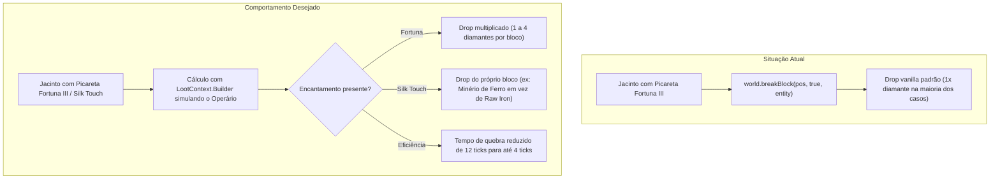

# Issue #1: Suporte a Encantamentos (Fortuna, Toque Suave e Eficiência) na Picareta do Jacinto

- **Tipo:** 🛠️ Melhoria / Mecânica (Feature & Compatibility)
- **Prioridade:** 🟡 Média-Alta
- **Módulo:** `JacintoItemakino` (`JacintoMiner.java`)
- **Status:** 📋 Aberto / Planejado

---

## 🎯 Objetivo & Visão Geral

Quando um jogador entrega uma ferramenta personalizada de alto nível ao Jacinto (como uma **Picareta de Diamante com Fortuna III**, **Toque Suave (Silk Touch)** ou **Eficiência V**), espera-se que o Jacinto usufrua de todos os bônus desses encantamentos durante suas operações de mineração autônoma.

Atualmente, o método `world.breakBlock(pos, true, entity)` utiliza a ferramenta em mãos para o cálculo vanilla básico, porém não replica integralmente o cálculo de loot table com parâmetros avançados do jogador (como bônus de sorte de mods como *Zenith*, *Tierify* ou encantamentos customizados do *Simply Swords*).

---

## 🔍 Comportamento Atual vs Esperado

---

## 💡 Como Implementar (Sugestão Técnica)

1. **Eficiência (Dig Speed):**
   - No loop `digProgressTicks`, calcular a velocidade com base no nível do encantamento `EnchantmentHelper.getLevel(Enchantments.EFFICIENCY, heldPickaxe)`.
   - Exemplo: `int ticksNeeded = Math.max(3, 12 - (efficiencyLevel * 2));`
2. **Fortuna e Toque Suave (Drop Generation):**
   - Ao quebrar o bloco, utilizar `Block.getDroppedStacks(state, (ServerWorld) world, pos, blockEntity, entity, heldPickaxe)` para capturar a lista real de itens gerados.
   - Entregar esses itens diretamente para a contagem do lote de transporte (`carriedItemCount`), garantindo que se 1 veio render 3 diamantes por causa de Fortuna, os 3 itens entrem no baú da firma!

---

## ✅ Critérios de Aceite

- [ ] Jacinto com Picareta de Fortuna III consegue coletar múltiplos diamantes/carvões de um único bloco.
- [ ] Jacinto com Toque Suave guarda o minério em bloco no baú quando solicitado.
- [ ] Picaretas com Eficiência V quebram os blocos visivelmente mais rápido.
- [ ] Ferramentas gastam durabilidade normalmente a cada bloco quebrado.
