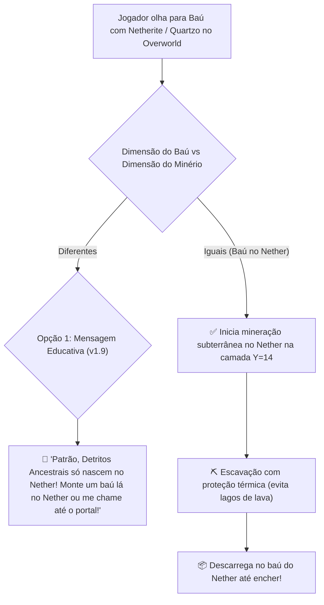

# Issue #2: Mineração Interdimensional (Nether & The End) e Tratamento de Portais

- **Tipo:** 🚀 Nova Funcionalidade (Feature)
- **Prioridade:** 🔴 Alta
- **Módulo:** `JacintoItemakino` (`JacintoMiner.java`, `JacintoCommands.java`)
- **Status:** ✅ Concluído / Implementado na v2.0.0

---

## 🎯 Objetivo & Visão Geral

Minérios como **Detritos Ancestrais (Ancient Debris / Netherite)** e **Quartzo do Nether** só existem naturalmente na dimensão do Nether (`minecraft:the_nether`).
Atualmente, se um jogador no Overworld colocar uma moldura com Netherite em um baú do castelo e digitar `/minerar`, o Jacinto tenta minerar na camada Y=14 do Overworld (onde Detritos não existem naturalmente), ficando em prospecção contínua (strip-mining infinito).

Precisamos de uma regra inteligente que gerencie minerações interdimensionais ou oriente o jogador de forma clara e amigável.

---

## 🔍 Ilustração do Fluxo

---

## 💡 Proposta de Implementação

1. **Validação de Dimensão Adequada (Fase 1 - Imediata):**
   - No método `startMiningWithChest`, verificar a dimensão nativa do minério solicitado:
     - `ancient_debris`, `nether_quartz_ore`, `nether_gold_ore` -> Dimensão obrigatória: `minecraft:the_nether`.
     - Se o baú de destino estiver em outra dimensão, o Jacinto avisa cordialmente:
       > *"§e[Jacinto Itemakino Baú] §cPatrão, esse minério só existe nas profundezas do Nether! Coloque o baú no Nether para que eu possa minerar e guardar diretamente lá!"*
2. **Navegação Interdimensional Automática (Fase 2 - Futura):**
   - Permitir que o Jacinto memorize portais do Nether próximos à base para atravessar dimensões autonomamente e retornar ao Overworld para descarregar.

---

## ✅ Critérios de Aceite

- [ ] Pedir minérios do Nether com baú no Overworld gera mensagem explicativa imediata sem travar o NPC.
- [ ] Pedir minérios do Nether estando no Nether inicia a escavação com sucesso na altura Y=14.
- [ ] Jacinto respeita a imunidade a fogo/lava inerente a operários do Nether quando estiver nessa dimensão.
