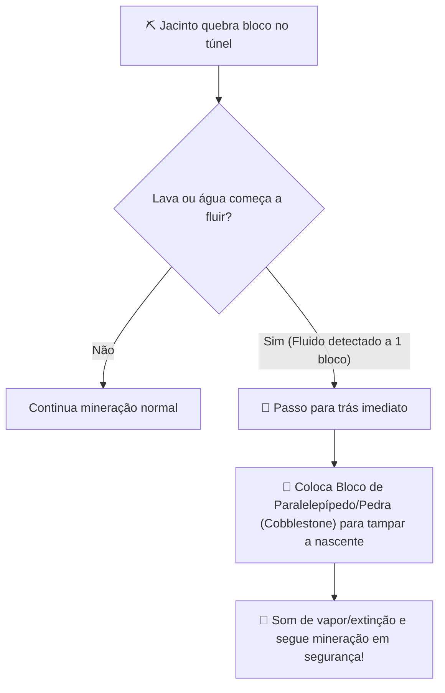

# Issue #3: Sistema Ativo de Contenção de Lava e Fluidos Perigosos

- **Tipo:** 🛡️ Robustez / Sobrevivência (AI & Pathfinding)
- **Prioridade:** 🟡 Média
- **Módulo:** `JacintoItemakino` (`JacintoMiner.java`)
- **Status:** ✅ Concluído / Implementado na v2.0.0

---

## 🎯 Objetivo & Visão Geral

Nas camadas profundas de mineração (Deepslate entre Y=-50 e Y=-58), é muito comum romper bolsões subterrâneos de lava ao escavar veios de diamante ou redstone.
Embora o Jacinto já conte com a verificação passiva `isSurroundedByLava` e evite quebrar blocos com lava diretamente acima, um fluxo lateral de lava inesperado pode colocá-lo em risco de dano ou interromper sua rota de volta ao baú.

---

## 🔍 Ilustração da Mecânica Proposta

```
        CENÁRIO ATUAL:                                CENÁRIO PROPOSTO:
  [Pedra]  [LAVA]  [Pedra]                     [Pedra]  [LAVA]  [Pedra]
  [Pedra]    ||    [Pedra]                     [Pedra]  [COBBLE] [Pedra]  <-- Jacinto tampa!
           \ v /                                          ||
         [Jacinto] (Em chamas)                         [Jacinto] (100% Ileso)
```



---

## 💡 Proposta de Implementação

1. **Detecção de Fluxo de Fluido:**
   - No loop `ServerTick`, verificar se algum bloco adjacente ao Jacinto se transformou em `Fluids.FLOWING_LAVA` ou `Blocks.LAVA`.
2. **Ação de Bloqueio com Cobblestone Virtual:**
   - O Jacinto, como um minerador profissional que acumula pedregulhos ao cavar túneis, tem capacidade infinita de contenção.
   - Substituir imediatamente o bloco de lava fluida por `Blocks.COBBLESTONE` com partícula de fumaça (`ParticleTypes.SMOKE`) e som de extinção (`SoundEvents.BLOCK_LAVA_EXTINGUISH`).

---

## ✅ Critérios de Aceite

- [ ] Jacinto nunca morre queimado por bolsões de lava que se abrem lateralmente ao minerar diamantes.
- [ ] O caminho de volta para o baú não fica bloqueado por poças de lava fresca criadas na escavação.
