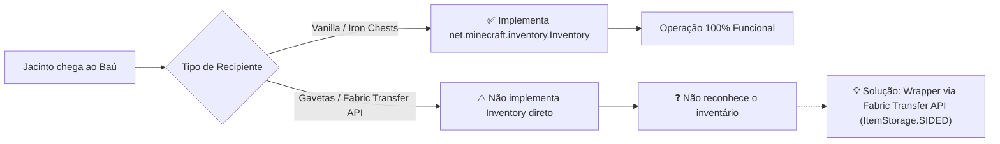

# Issue #7: Suporte Avançado a Baús de Mods (Iron Chests, Storage Drawers e Shulker Boxes)

- **Tipo:** 🧩 Compatibilidade de Mods (Mod Compatibility)
- **Prioridade:** 🟡 Média
- **Módulo:** `JacintoItemakino` (`JacintoOrganizer.java`, `JacintoMiner.java`)
- **Status:** 📋 Aberto / Sugestão

---

## 🎯 Objetivo & Visão Geral

O modpack Prominence II inclui diversos mods de armazenamento, tais como:
- **Iron Chests** (Baús de Ferro, Ouro, Diamante, Obsidiana com capacidades de 54 até 108 slots).
- **Traveler's Backpack** e **Shulker Boxes** no chão.
- **Functional Storage / Storage Drawers** (Gavetas com travas de item).

Atualmente, o método `JacintoOrganizer.getInventoryAtPos` verifica `BlockEntity` vanilla que implementam `Inventory` ou `DoubleInventory`. Em gavetas ou blocos de mods que utilizam sistemas Fabric Transfer API (`ItemStorage.SIDED`), alguns recipientes podem não ser reconhecidos como inventários tradicionais.

---

## 🔍 Ilustração

---

## 💡 Proposta de Implementação

1. **Fallback com Fabric Transfer API:**
   - Adicionar uma checagem secundária em `JacintoOrganizer.getInventoryAtPos`:
   - Se `world.getBlockEntity(pos)` não for um `Inventory`, consultar:
     `Storage<ItemVariant> storage = ItemStorage.SIDED.find(world, pos, Direction.UP);`
   - Criar um adaptador simples para ler e inserir itens através do sistema de Storage do Fabric API.
2. **Cálculo de Capacidade:**
   - Para detecção de "Baú Cheio" na mineração, somar a capacidade real de todos os slots do inventário específico, permitindo ao Jacinto encher completamente até mesmo um **Baú de Diamante (108 slots)** sem parar prematuramente!

---

## ✅ Critérios de Aceite

- [ ] Jacinto consegue organizar e descarregar minérios em Baús de Ferro, Ouro e Diamante do mod Iron Chests.
- [ ] Jacinto reconhece Shulker Boxes posicionadas no chão como destino válido.
- [ ] O cálculo de baú cheio funciona perfeitamente para qualquer tamanho de inventário.
