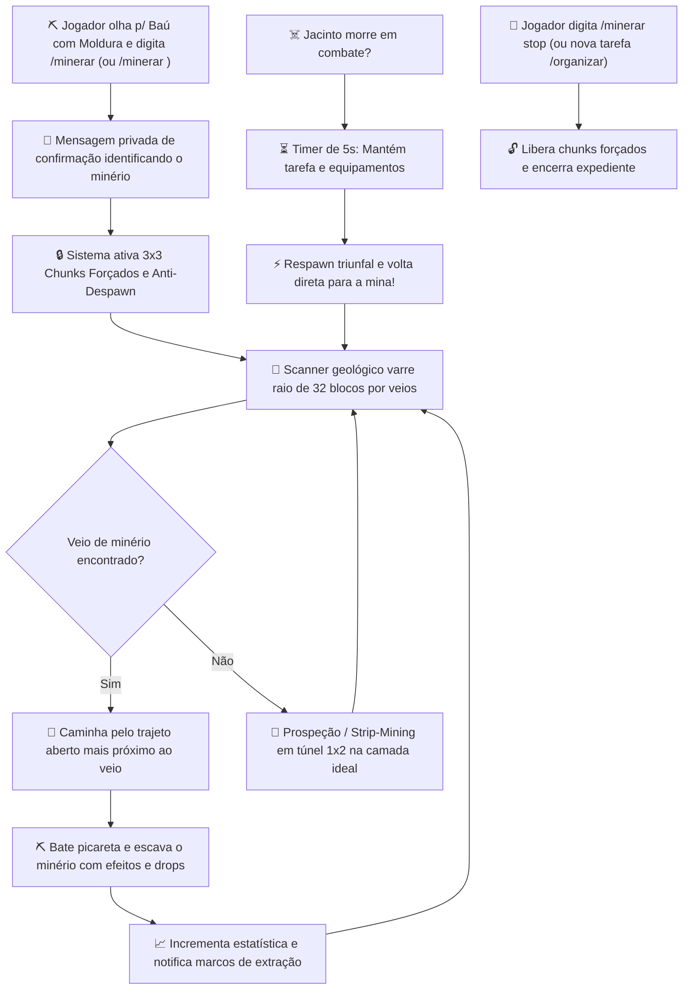
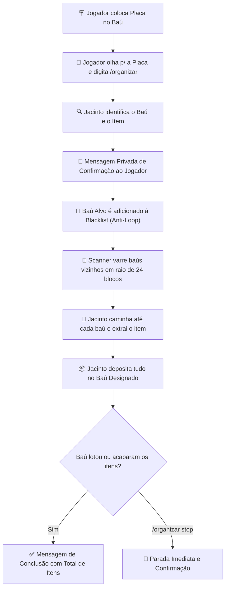

# 📦 Jacinto Itemakino Baú

> **Mod Oficial Server-Side para Fabric 1.20.1 — CanalhasSMP**  
> *"Jacinto organizando, minerando e a firma prosperando! Deixa que o Jacinto bota ordem na bagunça e traz os minérios pra base."*

---

## 📖 Visão Geral

O **Jacinto Itemakino Baú** é um NPC operário inteligente, carismático e multifuncional criado para a firma CanalhasSMP. Ele combina três grandes funções:

1. **📦 Organização Inteligente de Baús**: Lê a placa de um baú e varre recipientes vizinhos em 24 blocos, concentrando os itens com **proteção total contra loops infinitos**.
2. **⛏️ Mineração Passiva e Autônoma**: Você pede um item/minério para ele e ele ativa seu **scanner geológico de 32 blocos**, caminha pelo trajeto mais acessível e começa a escavar os veios de minério sem parar!
3. **⚔️ Proteção da Base e Persistência**: Pode ser equipado com quaisquer armas/armaduras de jogador, patrulha a base atacando monstros hostis e **nunca despawna** — graças a um sistema dinâmico de **3x3 Chunks Forçados**, continuando seu trabalho mesmo quando nenhum jogador está por perto! Se morrer, respawna em 5 segundos e retoma a tarefa imediatamente!
4. **👷 Postura Pacífica e Status de Aliado da Firma (v1.6.0)**: Jacinto não persegue e nem agarra jogadores (braços baixados), possui colisão desativada para players passarem através dele sem travar portas/baús, é **100% imune a ataques de jogadores e NPCs companheiros (como a Vitória)** e **não dropa XP**, prevenindo qualquer tipo de farm indevido! Apenas monstros hostis podem atacá-lo.
5. **🏰 Proteção de Construções & Integração com Claims (v1.7.0)**: Integrado nativamente com o sistema de claims do Prominence II (**Open Parties and Claims - OPAC** e **FTB Chunks**). Chunks protegidos por players ou parties são 100% invioláveis! Para materiais de construção (Andesito, Granito, Diorito, Pedras), ele desce compulsoriamente para o subsolo profundo (abaixo de Y=40), protegendo castelos de jogadores (como o castelo do Jodevil) de qualquer escavação acidental!
6. **🪵 Ferramentas Padrão Infinitas, Desgaste e Tabela de Compatibilidade (v1.8.0)**: Por padrão, Jacinto sempre possui uma **Espada, Picareta e Pá de Madeira Infinitas** (`Unbreakable: true`). Jogadores podem presenteá-lo com ferramentas melhores via botão direito. Ferramentas de jogador sofrem desgaste real e, quando quebram, Jacinto reverte automaticamente para suas ferramentas de madeira da firma! Ele consulta a **Tabela de Compatibilidade de Mineração** (Harvest Tier) antes de minerar; se sua picareta atual não tiver nível suficiente para extrair o minério pedido (ex: pedir Diamante com Picareta de Madeira), ele se recusa, explica o motivo detalhadamente e orienta qual picareta precisa!

---

## 🔄 Fluxos de Funcionamento

### 1. Fluxo de Mineração Passiva Autônoma (`/minerar`)



### 2. Fluxo de Organização de Baús (`/organizar`)



---

## ⛏️ Como Usar a Mineração Passiva com Depósito em Baú (v1.5.0)

> [!IMPORTANT]
> **Regra Obrigatória:** O Jacinto precisa saber onde guardar o que minerar! Para qualquer comando de mineração (`/minerar`), você **deve estar olhando diretamente para o Baú ou Barril** de destino. Se você rodar o comando sem olhar para um baú, o Jacinto avisará de forma clara e direta:
> `[Jacinto Itemakino Baú] Patrão, você precisa estar olhando diretamente para um baú (ou barril) para que eu possa iniciar a mineração e saber onde guardar os itens!`

Você pode iniciar a mineração de duas formas:

### Opção 1: 💬 Olhar para o Baú e Digitar o Item
Olhe diretamente para o baú onde deseja que os itens sejam guardados e digite o comando com o nome do item/bloco (em português, inglês ou ID):
```minecraft
/minerar Andesito
```
- **Outros exemplos populares:**
  - `/minerar diamante` (ou `diamond`)
  - `/minerar ferro` (ou `iron`, `raw_iron`)
  - `/minerar ouro` (ou `gold`)
  - `/minerar pedra` (ou `pedregulho`, `cobblestone`)
  - `/minerar carvao` (ou `coal`)
  - `/minerar cobre` (ou `copper`)
  - `/minerar redstone`
  - `/minerar lapis`
  - `/minerar esmeralda`
  - `/minerar ancient_debris` (ou `debris`, `netherite`)
  - `/minerar quartzo` (ou `quartz`)

### Opção 2: 🖼️ Olhar para o Baú com Moldura (Modo Visual)
1. Coloque uma **Moldura** no baú contendo o item pretendido (por exemplo: um bloco de **Andesito**, como no armazém da firma).
2. Olhe diretamente para o baú (ou para a moldura nele) e digite apenas:
   ```minecraft
   /minerar
   ```
3. O Jacinto detecta a moldura no baú, reconhece o item e inicia a mineração com destino àquele mesmo baú!

---

### 📦 Enchimento Automático e Modo IDLE
- O Jacinto vai para o subterrâneo escavar os blocos com seu **scanner de 32 blocos**, mantendo chunks forçados e anti-despawn.
- Conforme coleta os blocos, ele retorna ao baú designado e descarrega os itens.
- **Ao encher o baú completamente:**
  - O Jacinto toca som comemorativo (`challenge complete`), solta partículas festivas e envia uma mensagem informando que a missão foi cumprida:
    > `[Jacinto Itemakino Baú] Missão cumprida, patrão! O baú designado para [Andesito] foi completamente ENCHIDO! 📦🎉 Entrando em modo de descanso (IDLE).`
  - O Jacinto encerra a mineração e entra em modo **IDLE** (patrulha e descanso na base) até receber uma nova tarefa dos jogadores!

---

## 🌐 Tecnologia Anti-Despawn e Chunks Forçados (Trabalho Contínuo a Distância)

No Minecraft vanilla, entidades normais entram em *despawn* ou congelam quando os jogadores se afastam mais de 32 ou 128 blocos, e os chunks são descarregados da memória.

Para resolver isso de forma 100% confiável no Jacinto:
1. **Persistência Total:** O Jacinto recebe flag de persistência permanente (`cannotDespawn`).
2. **Carregamento Dinâmico 3x3 (Forced Chunks):** Enquanto está minerando, o Jacinto mantém um grid de **9 chunks (3x3)** centralizados na posição dele forçados via API nativa de chunks (`setChunkForced`).
3. **Sem Vazamento de Memória:** Conforme o Jacinto avança caminhando pelo subterrâneo, os chunks antigos que ficaram para trás são liberados e os novos são ativados.
4. **Trabalho Sem Jogadores:** Ele continua minerando normalmente mesmo se todos os jogadores saírem do servidor ou estiverem em outra dimensão (Nether / The End)!

---

## 🔁 Persistência Ininterrupta Através de Mortes e Restarts

- **A Tarefa Nunca é Perdida:** A tarefa atual (`MINING`, `ORGANIZING` ou `IDLE`) e o alvo de mineração ficam salvos em `config/jacinto/jacinto_data.json`.
- **Morte em Combate:** Se monstros derrotarem o Jacinto na mina:
  1. Seus itens e picareta **não caem no chão** e ficam salvos em segurança.
  2. Um timer de 5 segundos é disparado.
  3. Ele renasce com 20 HP, equipa suas ferramentas e **volta imediatamente para a coordenada da mina para continuar escavando**!
  4. Manda frase cômica no chat:
     > `[Jacinto Itemakino Baú] Morri mas voltei com sede de minério! Retomando a picareta e a extração de [Diamante] imediatamente! ⛏️🔥`

---

## 📦 Como Usar a Organização de Baús (Passo a Passo)

O Jacinto oferece **3 formas intuitivas** para você definir qual item aquele baú deve receber:

### Opção A: 🖼️ Usando uma Moldura com o Item (Mais Fácil e Prático!)
1. Coloque uma **Moldura** (normal ou brilhante) diretamente na frente, em cima ou ao lado do seu baú.
2. Coloque o **item de referência** dentro da moldura (ex: Andesito, Diamante, Barra de Ferro, etc.).
3. Mire a mira do jogo diretamente na **Moldura** (ou no próprio baú com a moldura) e digite:
   ```minecraft
   /organizar
   ```
4. O Jacinto lê o item exato contido na moldura na hora e traz todos os itens correspondentes dos baús vizinhos!

### Opção B: 🪧 Usando uma Placa com o Nome do Item
1. Coloque uma placa grudada no baú ou no chão em frente a ele.
2. Escreva o nome do item (ex: `Andesito`, `Diamante`, `Ferro`, `Pedra`, etc.).
3. Mire na placa e digite `/organizar`.

### Opção C: 📦 Usando um Item Exemplo dentro do Baú
1. Se você já tiver colocado ao menos um exemplar do item dentro do baú (suporta **Baús Duplos grandes** em qualquer um dos 54 slots).
2. Mire no baú e digite `/organizar`. O Jacinto usará o item do baú como gabarito automático!

---

## 🔒 Permissões e Regras de Baús (Ignorar, Entrada e Saída)

Você pode personalizar individualmente como o Jacinto interage com cada baú da base! Basta olhar diretamente para o baú desejado (ou para a placa/moldura dele) e executar:

| Comando | Pode Colocar (Destino) | Pode Retirar (Origem) | Função Prática |
| :--- | :---: | :---: | :--- |
| `/organizar sim sim` | ✅ **SIM** | ✅ **SIM** | **Fluxo Normal (Padrão)**: Baú livre tanto para receber itens quanto para ter itens retirados. |
| `/organizar sim nao` | ✅ **SIM** | ❌ **NÃO** | **Baú de Depósito**: O Jacinto pode guardar itens aqui, mas **NUNCA** retira nada dele para outros baús! |
| `/organizar nao sim` | ❌ **NÃO** | ✅ **SIM** | **Baú de Despejo (Dump Chest)**: O Jacinto esvazia os itens daqui para a base, mas **NUNCA** guarda nada de volta nele! |
| `/organizar nao nao` | ❌ **NÃO** | ❌ **NÃO** | **Ignorado**: O Jacinto nunca mexe neste baú (mesmo efeito de `/organizar ignore`). |
| `/organizar ignore` | ❌ **NÃO** | ❌ **NÃO** | Atalho direto para fazer o Jacinto ignorar totalmente o baú. |

> [!TIP]
> Se o baú for um **Baú Duplo (Grande)**, a regra configurada se aplica automaticamente a ambas as metades simultaneamente!

---

## ⚔️ Equipamentos, Vida e Defesa da Base

| Característica | Detalhes |
| :--- | :--- |
| **Vida Máxima** | **20 HP** (10 corações normais de jogador). |
| **Aparência de Operário** | Veste uniforme completo de operário (Capacete/Gorro, Peitoral, Calça jeans, Botas de trabalho e Picareta de Ferro). Caso o jogador dê armaduras melhores (Diamante/Netherita), ele mantém as peças do jogador! |
| **Postura Humana** | Braços relaxados para baixo (não anda de braços levantados como zumbi). |
| **Sem Colisão (No-Clip)** | Membro da equipe `jacinto_team` com regra `CollisionRule.NEVER`: jogadores atravessam o Jacinto livremente, sem empurrões nem bloqueios em portas ou baús. |
| **Combate e Defesa** | Ao avistar monstros hostis (creepers, zumbis, esqueletos) em até 14 blocos, parte para o ataque com sua ferramenta/arma. |
| **Proteção Contra Fogo Amigo** | **100% Imune a dano de jogadores**: cliques de espada, flechas e sweeps não conectam, exibindo aviso no action bar. |
| **Proteção Contra Aliados** | NPCs companheiros (como a **Vitória** do Prominence II), guardas aldeões, golens e pets de jogadores não atacam o Jacinto. Se tentarem, o alvo é desativado imediatamente. |
| **Anti-Farm de XP** | **Não dropa absolutamente nada de XP ao morrer** (`experienceDroppingDisabled`), impossibilitando exploração indevida de experiência. |
| **Danos Sofridos** | Apenas monstros hostis de verdade causam dano ao Jacinto. Se derrotado em combate, seus itens ficam 100% seguros e ele renasce em 5 segundos! |

### 🦺 Como Dar Equipamentos para o Jacinto:
- **Equipar:** Basta **clicar com o botão direito** no Jacinto segurando armadura (Capacete, Peitoral, Calça, Bota), Picareta, Espada ou Escudo.
- **Troca Justa:** Se ele já estiver usando uma peça naquele slot, veste a nova e **devolve a peça antiga para o seu inventário**.
- **Consulta de Status:** Use **Shift + Botão Direito com a mão vazia** para ver a vida dele, equipamentos, tarefa atual e recorde histórico de minérios e baús organizados!

---

## 📜 Lista Completa de Comandos

| Comando | Descrição | Permissão |
| :--- | :--- | :--- |
| `/organizar` | Inicia a organização de baús mirando no baú, placa ou moldura. | Todos |
| `/organizar ignore` | Faz o Jacinto ignorar totalmente o baú mirado (não coloca e não tira). | Todos |
| `/organizar sim sim` | Permite o Jacinto colocar e retirar itens do baú mirado (padrão). | Todos |
| `/organizar sim nao` | Permite o Jacinto colocar itens, mas **nunca retirar** (baú depósito). | Todos |
| `/organizar nao sim` | Permite o Jacinto retirar itens, mas **nunca colocar** (baú despejo/dump). | Todos |
| `/organizar nao nao` | Faz o Jacinto ignorar totalmente o baú mirado (mesmo que `ignore`). | Todos |
| `/organizar stop` | Interrompe imediatamente a organização de baús. | Todos |
| `/organizar status` / `/jacinto status` | Exibe a vida, coordenadas, tarefa e histórico de trabalho do Jacinto. | Todos |
| `/minerar` | Inicia a mineração passiva do item contido na Moldura do Baú mirado até enchê-lo. | Todos |
| `/minerar <item>` | Inicia mineração passiva do item/bloco desejado (ex: `/minerar Andesito`), guardando no Baú mirado até encher. | Todos |
| `/minerar stop` / `/minerar parar` | Interrompe a mineração e libera os chunks forçados. | Todos |
| `/minerar status` | Exibe item em mineração, baú de destino, blocos minerados na sessão e chunks forçados. | Todos |
| `/minerar compatibilidade` / `/minerar guia` | Exibe a Tabela de Compatibilidade de Picaretas e a picareta atual do Jacinto. | Todos |
| `/jacinto minerar` | Inicia mineração olhando para o baú com moldura. | Todos |
| `/jacinto minerar <item>` | Alias do comando de mineração passiva com baú de destino. | Todos |
| `/jacinto minerar compatibilidade` | Consulta o guia de níveis de picareta e compatibilidade de minérios. | Todos |
| `/jacinto parar` / `/jacinto stop` | Para qualquer tarefa ativa (mineração ou organização). | Todos |
| `/jacinto chamar` | Teleporta o Jacinto imediatamente para a sua posição. | Todos |
| `/jacinto base` | Define a sua localização atual como base de repouso oficial do Jacinto. | Todos |
| `/jacinto limpar` | Executa varredura e expurga instantaneamente cópias/clones duplicados do Jacinto. | Todos |
| `/jacinto respawn` | Força a reinvocação do Jacinto caso necessário. | OP (Nível 2) |

---

## ⚙️ Compilação e Instalação

Mod construído sobre o **Fabric Loom 1.7** para Minecraft **1.20.1** (Java 17):

### 1. Compilação do Código-Fonte:
```bash
# Na pasta JacintoItemakino/:
gradlew.bat build -x test
```
O arquivo JAR é gerado em:
`JacintoItemakino/build/libs/jacinto-itemakino-1.8.0.jar`

### 2. Instalação:
1. Copie o arquivo `jacinto-itemakino-1.8.0.jar` para a pasta `mods/` do servidor (ou execute `ATUALIZAR_JACINTO.bat`).
2. Inicie ou reinicie o servidor.
3. Não requer instalação no cliente dos jogadores (100% server-side).

---

## ☁️ Backup Automático do Servidor

O mod está integrado nativamente ao gerenciador de backup do ecossistema CanalhasSMP ([`ModSourceBackupManager`](../SenhorCummins/src/main/java/com/canalhas/cummins/ModSourceBackupManager.java)):
- A cada 15 minutos e ao encerrar o servidor, todo o código-fonte, scripts Gradle, JARs compilados e dados de persistência do Jacinto são sincronizados para `world/mods_desenvolvidos/` e enviados no `.zip` de backup do mundo.

---

*Desenvolvido com carinho para a firma CanalhasSMP.* 📦⛏️❤️
