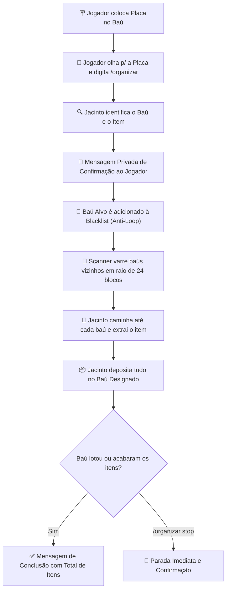

# 📦 Jacinto Itemakino Baú

> **Mod Oficial Server-Side para Fabric 1.20.1 — CanalhasSMP**  
> *"Jacinto organizando, a firma prosperando! Deixa que o Jacinto bota ordem na bagunça."*

---

## 📖 Visão Geral

O **Jacinto Itemakino Baú** é um NPC operário inteligente, carismático e protetor criado para resolver de vez a bagunça de baús no servidor. 

Basta colocar uma placa identificando o que vai em cada baú e usar o comando `/organizar`: o Jacinto lê a placa, varre todos os baús e barris da redondeza em até **24 blocos**, coleta os itens correspondentes e traz tudo para o baú de destino — **com proteção total contra loops infinitos**.

Enquanto não está organizando baús, o Jacinto atua como **guardião da base**, patrulhando a redondeza e atacando monstros hostis com as armaduras e armas que os jogadores derem a ele!

---

## 🔄 Fluxo de Funcionamento (Como Funciona)



---

## 🛠️ Como Usar na Prática (Passo a Passo Didático)

### Passo 1: Preparar o Baú e a Placa
1. Coloque o seu baú (simples ou duplo) ou barril no local desejado.
2. Coloque uma placa **na frente**, **em cima** ou **grudada na lateral** do baú.
3. Escreva na placa o nome do item que aquele baú deve armazenar.
   - **Exemplos aceitos em Português:** `Diamante`, `Ferro`, `Barra de Ferro`, `Ouro`, `Cobre`, `Carvão`, `Redstone`, `Esmeralda`, `Pedra`, `Pedregulho`, `Madeira`, etc.
   - **Exemplos em Inglês / ID:** `diamond`, `iron_ingot`, `raw_iron`, `cobblestone`.
   - **Identificação por Conteúdo:** Se a placa tiver um apelido ou estiver decorada, mas o baú já contiver o item dentro, o Jacinto detecta automaticamente o item existente no baú!

### Passo 2: Executar o Comando
Mire a mira do jogo diretamente para a placa (ou para o baú com a placa) e digite no chat:
```minecraft
/organizar
```

### Passo 3: Confirmação e Trabalho
O Jacinto responderá imediatamente no seu chat privado:
> `[Jacinto Itemakino Baú] Opa, patrão Asminn! Identifiquei o item: [Diamante]. Revistando 8 baús vizinhos para concentrar tudo aqui...`

Ele começará a caminhar entre os baús da base, abrindo os recipientes com efeitos sonoros e partículas, transferindo todos os itens correspondentes para o baú central.

### Passo 4: Cancelar a Qualquer Momento
Se você precisar sair ou quiser interromper o trabalho do Jacinto no meio do trajeto, digite:
```minecraft
/organizar stop
```
O Jacinto puxará o freio de mão imediatamente e avisará quantos itens conseguiu guardar até aquele momento.

---

## 🛡️ Prevenção Total de Loop (Sem Retirar do Próprio Baú)

Um dos maiores desafios de NPCs organizadores é o perigo de entrar em loop: retirar o item de um baú e recolocá-lo no mesmo lugar.

No **Jacinto Itemakino**, esse problema foi eliminado na raiz:
1. Assim que a placa é lida, a posição do baú alvo (`targetChestPos`) é registrada.
2. Se for um **baú duplo**, o mod localiza automaticamente a outra metade conectada.
3. Ambas as metades são inseridas em uma **Lista Negra de Coleta (Blacklist)**.
4. O scanner de 24 blocos **ignora estritamente** essas coordenadas durante toda a rotina de busca.

---

## ⚔️ Equipamentos, Vida e Defesa da Base

O Jacinto é um operário duro na queda que protege a firma de invasores!

| Característica | Detalhes |
| :--- | :--- |
| **Vida Máxima** | **20 HP** (10 corações normais de jogador). |
| **Aparência** | Humanóide operário (Husk) — não queima sob o sol e renderiza todas as armaduras. |
| **Comportamento Passivo** | Patrulha a base num raio de 16 blocos enquanto ocioso. |
| **Combate** | Ao avistar monstros hostis (Zumbis, Creepers, Esqueletos, Aranhas) em até 14 blocos, parte para o ataque com sua arma equipada. |
| **Segurança Absoluta** | **Nunca ataca jogadores**, animais domesticados (lobos, gatos) ou aldeões. |

### 🦺 Como Dar Equipamentos para o Jacinto:
- **Equipar:** Basta **clicar com o botão direito** no Jacinto segurando qualquer item de equipamento:
  - **Capacetes, Peitorais, Calças e Botas** (Couro, Ferro, Diamante, Netherite, etc.).
  - **Armas e Ferramentas:** Espadas, Machados, Picaretas na mão principal.
  - **Mão Secundária:** Escudos ou Tochas.
- **Troca Justa:** Se ele já estiver usando uma peça naquele slot, ele veste a nova com som de armadura e **devolve a peça antiga para o seu inventário**!
- **Proteção de Inventário:** As armaduras e armas dadas ao Jacinto são salvas em arquivo (`config/jacinto/jacinto_data.json`). **Elas nunca dropam no chão e nunca são perdidas**.

### 📊 Como Ver o Status do Jacinto:
- Chegue perto dele e use **Shift + Clique Direito com a mão vazia**.
- Ele exibirá a vida atual, todas as armaduras/armas equipadas e o recorde histórico de itens que já organizou na carreira!

---

## 💀 Morte, Respawn em 5 Segundos e Frases Cômicas

Se o Jacinto for derrotado em combate por uma horda de monstros:
1. **Sem Perda de Loot:** Seus equipamentos não caem no chão; ficam guardados em segurança na memória.
2. **Timer de 5 Segundos:** Um cronômetro de 100 ticks (5 segundos) é iniciado no servidor.
3. **Retorno Triunfal:** Ele renasce na base com a vida cheia (20/20 HP) e com todas as suas armaduras e armas equipadas novamente.
4. **Frase no Chat Global:** Ele manda uma pérola bem-humorada para animar os jogadores:
   > - `[Jacinto Itemakino Baú] Rapaz, fui de base rapidão... tropecei na quina do baú, mas o Jacinto já tá vivinho da silva de novo! 📦💀`
   > - `[Jacinto Itemakino Baú] Bateram no Jacinto, mas esqueceram que vaso ruim não quebra! Já tô de pé pro trabalho!`
   > - `[Jacinto Itemakino Baú] Morri mas passo bem! 5 segundinhos de CLT remunerado e já voltei pra labuta da firma!`
   > - `[Jacinto Itemakino Baú] Quase que o Jacinto fica guardado no baú pra sempre, mas o plano de saúde da firma cobriu o respawn!`
   > - `[Jacinto Itemakino Baú] Derrubaram o peão, mas o Jacinto levanta mais rápido que entrega expressa! Quem é o próximo monstro?`

---

## 📜 Lista Completa de Comandos

| Comando | Descrição | Permissão |
| :--- | :--- | :--- |
| `/organizar` | Inicia a organização mirando na placa do baú. | Todos |
| `/organizar stop` / `/organizar parar` | Interrompe imediatamente o trabalho atual. | Todos |
| `/organizar status` / `/jacinto status` | Exibe a vida, coordenadas e tarefas do Jacinto. | Todos |
| `/organizar chamar` / `/jacinto chamar` | Teleporta o Jacinto imediatamente para o jogador. | Todos |
| `/jacinto base` | Define a sua posição atual como a base oficial de respawn do Jacinto. | Todos |
| `/jacinto respawn` | Força o respawn imediato do Jacinto via comando. | OP (Nível 2) |

---

## ⚙️ Como Compilar e Instalar

O mod é 100% autônomo e construído sobre o **Fabric Loom 1.7** para Minecraft **1.20.1** (Java 17):

### 1. Compilação do Código-Fonte:
No terminal da pasta `JacintoItemakino/`:
```bash
# Windows
gradlew.bat build -x test

# Linux / macOS
./gradlew build -x test
```
O arquivo final compilado será gerado em:
`JacintoItemakino/build/libs/jacinto-itemakino-1.0.1.jar`

### 2. Instalação no Servidor:
1. Copie o arquivo `jacinto-itemakino-1.0.1.jar` para a pasta `mods/` do servidor.
2. Inicie ou reinicie o servidor.
3. Não requer instalação no cliente dos jogadores (é puramente server-side).

---

## ☁️ Backup Automático do Servidor

O mod está integrado nativamente ao gerenciador de backup do ecossistema CanalhasSMP ([`ModSourceBackupManager`](../SenhorCummins/src/main/java/com/canalhas/cummins/ModSourceBackupManager.java)):
- A cada 15 minutos e a cada parada do servidor, todo o código-fonte, scripts Gradle, JARs compilados e arquivos de configuração do Jacinto são sincronizados para `world/mods_desenvolvidos/`.
- Quando o **Textile Backup** gera o `.zip` da pasta `world/` para a nuvem/Google Drive, o mod do Jacinto é salvo automaticamente junto!

---

*Desenvolvido com carinho para a firma CanalhasSMP.* 📦❤️
